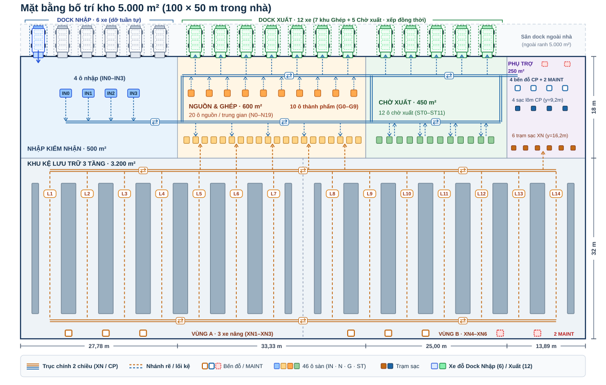
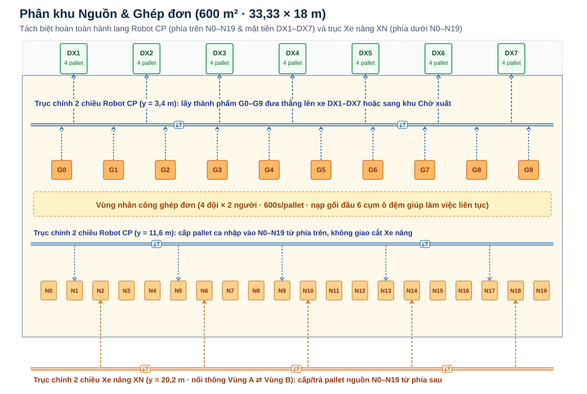
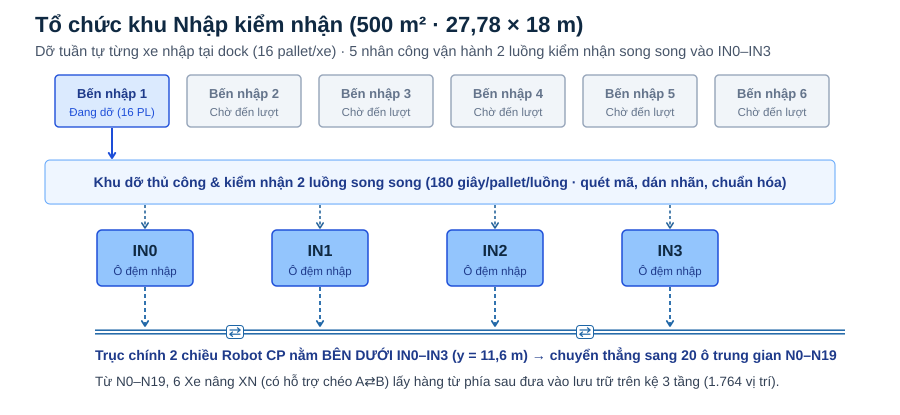
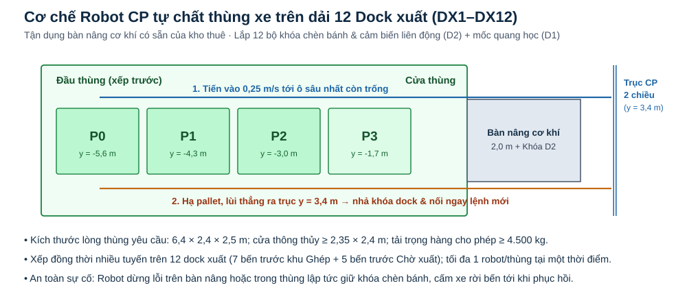

# Hệ thống Mô phỏng Điều phối Kho Tự động WinMart 5.000 m² (Phiên bản V6.1)

> **Đồ án Học phần Quản lý Dự án Công nghệ Thông tin**  
> **Trải nghiệm trực tiếp trên Web (GitHub Pages):** [https://outofideaman-dev.github.io/winmart-sim/](https://outofideaman-dev.github.io/winmart-sim/)

---

## 1. Giới thiệu tổng quan

Dự án mô phỏng hoạt động điều phối luồng pallet tự động theo bước thời gian **1 giây tất định (deterministic 1-second tick)** cho phân khu kho hàng khô tiêu chuẩn rộng **5.000 m² (`100 × 50 m` trong nhà)** phục vụ chuỗi bán lẻ WinMart/WinMart+.

### Mặt bằng tổng thể phân khu kho 5.000 m²


---

## 2. Cấu hình kỹ thuật & cơ chế điều phối cốt lõi

| Hạng mục thiết kế | Thông số kỹ thuật & quy tắc vận hành |
|---|---|
| **Quy hoạch diện tích (`5.000 m²`)** | Khu kệ lưu trữ `3.200 m²` (`100 × 32 m`) · Khu nhập & kiểm nhận `500 m²` · Khu nguồn & ghép đơn `600 m²` · Khu chờ xuất `450 m²` · Khu trạm sạc & phụ trợ `250 m²` |
| **Hệ thống kệ lưu trữ 3 tầng** | `14` lối kệ rộng `4,0 m` (`L1–L7` Vùng A, `L8–L14` Vùng B) × `2` mặt × `7` khoang × `3` vị trí/khoang × `3` tầng (`0,15 m; 1,95 m; 3,75 m`) = **`1.764` vị trí lý thuyết** (`1.499` vị trí khai thác ở mức `85%`, tồn đầu ca mẫu `72 pallet/SKU × 12 SKU = 864 pallet`) |
| **Đội phương tiện tự hành (`10 xe`)** | **`6` Xe nâng tự động Reach Truck (`XN1–XN6`)** (`3` xe Vùng A + `3` xe Vùng B) và **`4` Robot vận chuyển pallet (`CP1–CP4`)** |
| **Hành lang 2 chiều tách lớp** | Robot `CP` chạy trên trục ngang 2 chiều `y = 3,4 m` & `y = 11,6 m`; Xe nâng `XN` chạy trên trục ngang 2 chiều `y = 20,2 m`, `14` lối kệ `L1–L14` và hành lang hậu `y = 47,8 m` (không giao cắt với `CP`) |
| **Hỗ trợ chéo mềm A⇄B (`Cross-Zone`)** | Khi 3 xe nâng bản địa đều bận hoặc vùng đích có `≥ 2` lệnh chờ trong khi vùng lân cận rỗi, xe nâng vùng kia tự động vượt qua ranh `x = 50 m` trên trục `y = 20,2 m` sang hỗ trợ (cộng độ trễ điều phối `+35 giây`) |
| **Đa dock xuất (`DX1–DX12`)** | `12` cửa xuất (`7` cửa trước khu Ghép + `5` cửa trước khu Chờ xuất), mở đồng thời `6` tuyến cửa hàng (`4 pallet/xe`), robot `CP` tự tiến vào lòng thùng xếp hàng từ sâu ra cửa (`0,25 m/s`, khóa tối đa `1 robot/thùng`) |
| **Bến đỗ nhập (`DIN1–DIN6`)** | `6` bến đỗ xe tải nhà cung cấp (`16 pallet/xe`), dỡ tuần tự từng xe với `5` nhân công vận hành `2` luồng kiểm nhận song song (`180 giây/pallet/luồng`) vào `4` ô đệm `IN0–IN3` |
| **Giải phóng khóa sớm & Nối chuyến** | Phương tiện mở khóa lối kệ/cửa dock ngay khi lùi ra trục chính 2 chiều (`clear`) và nhận ngay nhiệm vụ kế tiếp từ tọa độ hiện tại mà không phải chạy rỗng về bến chờ |

---

## 3. Sơ đồ chi tiết các phân khu

### 3.1 Phân khu Nguồn & Ghép đơn (`600 m²` · `20` ô nguồn `N0–N19` & `10` ô thành phẩm `G0–G9`)


### 3.2 Phân khu Nhập & Kiểm nhận (`500 m²` · Dỡ tuần tự & `2` luồng kiểm nhận song song)


### 3.3 Cơ chế Robot tự chất hàng trên dải 12 Dock xuất (`DX1–DX12`)


---

## 4. Kết quả thực nghiệm định lượng (10 kịch bản)

Hệ thống vượt qua **17/17 nhóm kiểm thử bất biến tự động** ([`data/verification.json`](./data/verification.json)) và ghi nhận kết quả thực nghiệm tổng hợp tại [`data/summary.json`](./data/summary.json):

| STT | Kịch bản thực nghiệm | Thời lượng | Nhận | Cất kệ | Ghép | Chất xe | Rời kho | Chuyến xe | Hỗ trợ chéo A⇄B |
|---:|---|---:|---:|---:|---:|---:|---:|---:|---:|
| 1 | **Xuất 8 giờ cơ sở (Đa dock + Hỗ trợ chéo)** | 8 giờ | 0 | 0 | 188 | 207 | **202** | 51 | 2 |
| 2 | Khóa cứng vùng kệ (Tắt hỗ trợ chéo A⇄B) | 8 giờ | 0 | 0 | 188 | 206 | **202** | 51 | 0 |
| 3 | Thao tác nhân công chậm +25% | 8 giờ | 0 | 0 | 148 | 169 | **167** | 42 | 2 |
| 4 | Xe xuất đến trễ 2 giờ | 8 giờ | 0 | 0 | 159 | 180 | **170** | 43 | 2 |
| 5 | Bắt buộc qua ô chờ xuất (`ST0–ST11`) | 8 giờ | 0 | 0 | 188 | 205 | **200** | 50 | 2 |
| 6 | Thiếu tồn kho đầu ca (`2 pallet/SKU`) | 8 giờ | 0 | 0 | 36 | 39 | **39** | 10 | 0 |
| 7 | Bắt đầu ca với 15% pin (giới hạn `≤ 3` xe sạc đồng thời) | 8 giờ | 0 | 0 | 33 | 35 | **30** | 9 | 10 |
| 8 | Sự cố 1 robot dừng lỗi trong thùng xe 1 giờ | 8 giờ | 0 | 0 | 169 | 188 | **182** | 46 | 2 |
| 9 | **Ca nhập 8 giờ (Dỡ tuần tự, 2 luồng kiểm nhận)** | 8 giờ | **128** | **128** | 0 | 0 | 0 | 0 | 0 |
| 10 | **Nhiều ca liên tục đan xen 40 giờ** | 40 giờ | **336** | **336** | 388 | 433 | **433** | 111 | 44 |

---

## 5. Hướng dẫn sử dụng giao diện Web

1. Truy cập **[https://outofideaman-dev.github.io/winmart-sim/](https://outofideaman-dev.github.io/winmart-sim/)**.
2. Chọn **Kịch bản** trên thanh điều khiển (`Xuất 8 giờ cơ sở`, `Tắt hỗ trợ chéo A⇄B`, `Thao tác nhân công chậm +25%`, `Ca nhập 8 giờ`, `Nhiều ca liên tục 40 giờ`...) và nhấn **Đặt lại kịch bản**.
3. Nhấn **Chạy** (hoặc **Tiến 5 phút** để nhảy nhanh từng bước 300 giây), điều chỉnh tốc độ mô phỏng `10×`, `60×`, `300×`.
4. Có thể chọn bất kỳ phương tiện nào (`XN1–XN6`, `CP1–CP4`) để thử nghiệm **Gây lỗi xe** / **Phục hồi xe**, **Yêu cầu chuyển ca** hoặc **Tải trạng thái JSON** phục vụ đối soát.

---

## 6. Cấu trúc mã nguồn Repository

```text
├── index.html               # Giao diện điều khiển và bảng giám sát trực quan
├── styles.css               # Định dạng bố cục giao diện
├── app.js                   # Trình kết xuất Canvas 2D và xử lý sự kiện tương tác
├── core.js                  # Bộ máy mô phỏng tất định bước 1 giây (WinMartEngine)
├── map.svg                  # Bản vẽ mặt bằng tổng thể kho 5.000 m²
├── Khu_nguon_ghep.svg       # Sơ đồ phân khu Nguồn & Ghép đơn
├── Khu_nhap.svg             # Sơ đồ phân khu Nhập & Kiểm nhận
├── Chat_xe.svg              # Sơ đồ cơ chế robot tự chất thùng xe
├── data/
│   ├── summary.json         # Tổng hợp kết quả định lượng 10 kịch bản & thông số dự án
│   └── verification.json    # Biên bản kiểm thử tự động 17 nhóm bất biến
└── .nojekyll                # Cấu hình triển khai tĩnh trên GitHub Pages
```

---

## 7. Thành viên nhóm thực hiện

| Mã nhiệm vụ | MSSV | Họ và tên | Nội dung phụ trách chính |
|:---:|:---:|---|---|
| **NV1** | `11236145` | **Đặng Thanh Long** | Tổng hợp báo cáo Word, tích hợp điều lệ, phạm vi, WBS 135 ngày & Đường găng |
| **NV2** | `11243979` | **Dương Khánh Ly** | Dự toán chi phí CAPEX/OPEX, dòng tiền theo cổng M1–M6 & phân tích độ nhạy |
| **NV3** | `11243766` | **Nguyễn Tuấn Hiệp** | Kế hoạch nhân sự (339 ngày công, RACI, FTE), chất lượng, truyền thông & rủi ro |
| **NV4** | `11243789` | **Vũ Gia Minh** | Xây dựng bộ Slide thuyết trình & kịch bản điều phối bảo vệ đồ án |
| **NV5** | `11236168` | **Võ Minh Nghĩa** | Quy hoạch mặt bằng 5.000 m², kệ 3 tầng, sơ đồ kỹ thuật & bộ đặc tả PlantUML |
| **NV6** | `11218384` | **Vũ Hoàng An** | Phát triển bộ máy mô phỏng 2D (`WinMartEngine`), 17 kiểm thử bất biến & 10 kịch bản |
